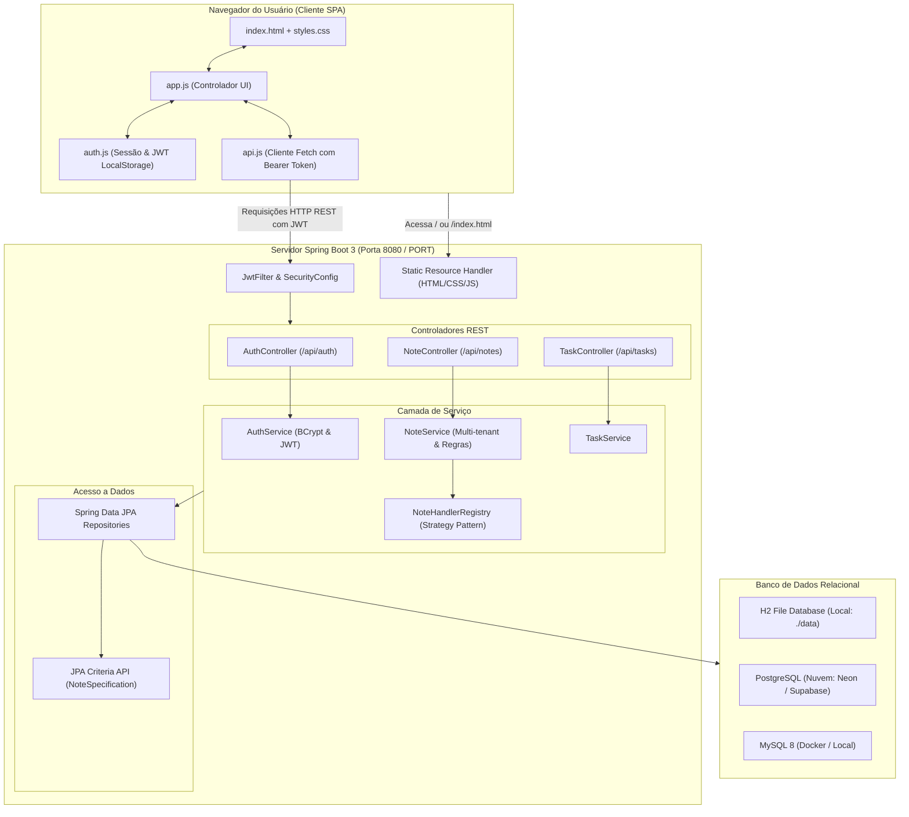

# NoteCore — Explicação Detalhada de Todo o Código do Projeto

Este documento explica de forma clara, didática e aprofundada **cada arquivo, classe, módulo e funcionalidade** do NoteCore, cobrindo o Back-end, o Front-end, o Banco de Dados e os arquivos de automação.

---

## 📑 Sumário

1. [Visão Geral da Arquitetura](#1-visão-geral-da-arquitetura)
2. [Back-End: Camada por Camada](#2-back-end-camada-por-camada)
   - 2.1 [Ponto de Entrada (`NoteServiceApplication.java`)](#21-ponto-de-entrada-noteserviceapplicationjava)
   - 2.2 [Autenticação e Segurança (`com.noteservice.auth`)](#22-autenticação-e-segurança-comnoteserviceauth)
   - 2.3 [Configurações de Segurança e Dados (`com.noteservice.config`)](#23-configurações-de-segurança-e-dados-comnoteserviceconfig)
   - 2.4 [Controladores REST (`com.noteservice.controller`)](#24-controladores-rest-comnoteservicecontroller)
   - 2.5 [Objetos de Transferência de Dados (`DTOs`)](#25-objetos-de-transferência-de-dados-dtos)
   - 2.6 [Regras de Negócio e Serviços (`com.noteservice.service`)](#26-regras-de-negócio-e-serviços-comnoteserviceservice)
   - 2.7 [Tratamento de Exceções (`com.noteservice.exception`)](#27-tratamento-de-exceções-comnoteserviceexception)
   - 2.8 [O Padrão de Projeto Strategy (`com.noteservice.strategy`)](#28-o-padrão-de-projeto-strategy-comnoteservicestrategy)
   - 2.9 [Entidades JPA e Modelagem (`com.noteservice.model`)](#29-entidades-jpa-e-modelagem-comnoteservicemodel)
   - 2.10 [Repositórios e Consultas Dinâmicas (`repository` e `specification`)](#210-repositórios-e-consultas-dinâmicas-repository-e-specification)
   - 2.11 [Módulo de Tarefas (`com.noteservice.task`)](#211-módulo-de-tarefas-comnoteservicetask)
3. [Front-End: Arquitetura Vanilla SPA](#3-front-end-arquitetura-vanilla-spa)
   - 3.1 [`index.html`: A Estrutura Visual](#31-indexhtml-a-estrutura-visual)
   - 3.2 [`css/styles.css`: Estilização e Temas](#32-cssstylescss-estilização-e-temas)
   - 3.3 [`js/api.js`: Cliente HTTP Inteligente](#33-jsapijs-cliente-http-inteligente)
   - 3.4 [`js/auth.js`: Gestor do Token JWT no Navegador](#34-jsauthjs-gestor-do-token-jwt-no-navegador)
   - 3.5 [`js/app.js`: O Controlador Central da Interface](#35-jsappjs-o-controlador-central-da-interface)
   - 3.6 [`js/i18n.js`: Dicionário e Tradução Dinâmica](#36-jsi18njs-dicionário-e-tradução-dinâmica)
4. [Bancos de Dados e Persistência](#4-bancos-de-dados-e-persistência)
5. [Scripts de Automação e Publicação](#5-scripts-de-automação-e-publicação)

---

## 1. Visão Geral da Arquitetura

O **NoteCore** foi construído como um **Monólito Modular Full-Stack**:
- O **Back-end** utiliza **Java 21**, **Spring Boot 3.3.5**, **Spring Data JPA**, **Hibernate 6** e **Spring Security 6**.
- O **Front-end** é uma **Single Page Application (SPA)** nativa feita em HTML5, CSS3 moderno e JavaScript ES6+, sem dependências externas pesadas (sem React, Vue ou Angular).
- O Spring Boot serve os arquivos estáticos diretamente do diretório `src/main/resources/static/` na mesma porta da API REST (`8080`), eliminando qualquer necessidade de Live Server ou proxies adicionais.

---

## 2. Back-End: Camada por Camada

### 2.1 Ponto de Entrada (`NoteServiceApplication.java`)
- **Caminho:** `back-end/src/main/java/com/noteservice/NoteServiceApplication.java`
- **O que faz:** É a classe executável do projeto, anotada com `@SpringBootApplication` e `@EnableScheduling`.
- **Destaque:** `@EnableScheduling` habilita rotinas agendadas em segundo plano, como a limpeza automática de notas expiradas na lixeira (`TrashPurgeService`).

---

### 2.2 Autenticação e Segurança (`com.noteservice.auth`)

Este pacote gerencia a criação de contas, login e a validação criptográfica de cada chamada recebida pela API.

#### `AuthController.java`
- Expõe dois endpoints públicos fundamentais:
  - `POST /api/auth/register`: Recebe um `SignupRequest` contendo nome, e-mail e senha. Valida os campos com `@Valid` e chama `AuthService.register()`.
  - `POST /api/auth/login`: Recebe um `LoginRequest` com e-mail e senha, autentica o usuário e devolve o token JWT assinado.

#### `AuthService.java`
- Contém a regra de negócio da segurança:
  1. **Cadastro:** Antes de criar a conta, consulta o banco com `userRepository.existsByEmailIgnoreCase(request.email())`. Se já existir, recusa com uma exceção `BusinessRuleException`. Caso contrário, codifica a senha com `passwordEncoder.encode(request.password())` usando o algoritmo **BCrypt** com sal (*salt*) aleatório.
  2. **Login:** Busca o usuário pelo e-mail ignorando maiúsculas/minúsculas. Se encontrado, valida a senha com `passwordEncoder.matches(request.password(), user.getPasswordHash())`. Se a senha bater, chama `jwtUtil.generateToken()` e retorna o token de acesso.

#### `JwtUtil.java`
- O "motor" criptográfico dos tokens:
  - Utiliza a biblioteca oficial **JJWT (io.jsonwebtoken)**.
  - Gera chaves HMAC-SHA seguras a partir da propriedade `notecore.jwt.secret`.
  - Método `generateToken(userId, email, name)`: Emite um token contendo o `id` do usuário como *subject*, as informações de perfil como *claims* e o prazo de expiração (24 horas por padrão).
  - Método `isValid(token)`: Confere a assinatura criptográfica e a data de validade. Se o token tiver sido adulterado por alguém, é rejeitado imediatamente.
  - Métodos `getUserId(token)` e `getEmail(token)`: Extraem com segurança a identidade do usuário a partir do token.

#### `JwtFilter.java`
- É um filtro HTTP do tipo `OncePerRequestFilter`:
  - É executado em **todas as requisições que chegam ao servidor**.
  - Procura o cabeçalho `Authorization: Bearer <token>`.
  - Se o token for válido, cria um objeto `UsernamePasswordAuthenticationToken` contendo o ID e o e-mail do usuário e o injeta no `SecurityContextHolder`.
  - Dessa forma, qualquer Controller subsequente sabe exatamente qual usuário está fazendo a requisição sem precisar consultar o banco de novo.

---

### 2.3 Configurações de Segurança e Dados (`com.noteservice.config`)

#### `SecurityConfig.java`
- Configuração do **Spring Security 6**:
  - `csrf(AbstractHttpConfigurer::disable)`: O CSRF é dispensável porque a API é *stateless* e autenticada via token Bearer no cabeçalho (não utiliza cookies de sessão).
  - `sessionManagement(SessionCreationPolicy.STATELESS)`: Garante que o servidor não aloque memória para sessões HTTP de usuários.
  - `authorizeHttpRequests()`:
    - **Rotas Públicas:** `/`, `/index.html`, `/css/**`, `/js/**`, `/assets/**`, `/api/auth/**`, `/h2-console/**`.
    - **Rotas Privadas:** Todas as demais (`/api/notes/**`, `/api/tasks/**`) exigem token válido.
  - `corsConfigurationSource()`: Habilita requisições seguras entre diferentes origens para permitir integrações flexíveis.
  - `userDetailsService()`: Registra um bean explícito para eliminar avisos e senhas desnecessárias no log na inicialização.

#### `DataInitializer.java`
- Classe anotada com `@Configuration` e `@Profile("!test")`.
- Ao iniciar a aplicação, verifica se a conta de demonstração `ana.moura@notecore.com` existe. Se não existir, cria a usuária e adiciona 4 notas ricas (uma de cada tipo: Texto, Markdown, Checklist e Código) e 3 tarefas para que o usuário não abra o sistema com uma tela vazia.
- **Idempotente:** Se a conta já existir, ele não faz nada, preservando quaisquer alterações feitas pelo usuário.

---

### 2.4 Controladores REST (`com.noteservice.controller`)

#### `NoteController.java`
- Centraliza os endpoints RESTful de gerenciamento de anotações:
  - `POST /api/notes`: Cria uma nova nota para o usuário autenticado.
  - `GET /api/notes`: Lista as notas ativas com suporte a paginação e ordenação (`Pageable`).
  - `GET /api/notes/all`: Retorna todas as notas ativas do usuário sem paginação (usado pela SPA para carregar o dashboard).
  - `GET /api/notes/{id}`: Busca uma nota por ID, conferindo se ela realmente pertence ao usuário logado.
  - `PUT /api/notes/{id}`: Atualiza título, conteúdo, tags, urgência ou status da nota.
  - `DELETE /api/notes/{id}`: Exclui a nota do banco.
  - `GET /api/notes/search?q=termo`: Pesquisa textual rápida por substring em títulos, autores, categorias e tags.
  - `GET /api/notes/filter`: Filtro combinado por tipo, categoria, autor e tag.
  - `GET /api/notes/tags`: Lista o catálogo de todas as tags distintas que o usuário possui.
  - `GET /api/notes/categories`: Lista as categorias criadas pelo usuário.
  - `POST /api/notes/{id}/tags` e `DELETE /api/notes/{id}/tags/{tag}`: Adiciona ou remove tags avulsas.

---

### 2.5 Objetos de Transferência de Dados (`DTOs`)

O projeto utiliza os **Records do Java moderno** (`java.lang.Record`), que são imutáveis, possuem construtores canônicos automáticos e eliminam código repetitivo de getters e setters:
- `NoteRequest.java`: Contém os dados de entrada para criação ou edição de uma nota (tipo, título, categoria, autor, tags, conteúdo, itens de checklist, urgência, favorito, deletado).
- `NoteResponse.java`: Contém os dados completos da nota que voltam para o cliente (incluindo datas de criação e alteração formatadas).
- `ChecklistItemDto.java`: Representa um item individual de lista (`itemText` e status `done`).
- `LoginRequest.java` e `SignupRequest.java`: DTOs de autenticação com validação estrita (`@NotBlank`, `@Email`, `@Size(min=6)`).
- `ErrorResponse.java`: Estrutura padronizada de mensagens de erro contendo status HTTP, mensagem principal e lista de inconsistências.

---

### 2.6 Regras de Negócio e Serviços (`com.noteservice.service`)

#### `NoteService.java`
- É o coração das regras de negócio das anotações:
  - **Isolamento Multi-tenant Estrito:** O método `getUser(userId)` garante que todas as consultas ao banco incluam o ID do usuário conectado. Um usuário jamais conseguirá ver ou alterar notas de terceiros, mesmo que adivinhe o ID numérico da nota de outra pessoa.
  - **Validação de Títulos Únicos:** Impede que um usuário crie duas notas ativas com o mesmo título (`existsByTitleIgnoreCaseAndUser`).
  - **Sanitização de Tags:** Limpa espaços em branco, converte tags para minúsculas e remove repetições através de um `LinkedHashSet`.
  - **Coordenação do Polimorfismo:** Encaminha a criação e atualização da nota para o manipulador correspondente através do `NoteHandlerRegistry`.

#### `TrashPurgeService.java`
- Serviço em segundo plano com agendamento `@Scheduled(fixedRate = 3600000)` (executado a cada 1 hora):
  - Verifica todas as notas marcadas como excluídas (`deleted = true`).
  - Se a data de envio para a lixeira for superior a 30 dias (configurável via `notecore.trash.retention-days`), a nota é removida permanentemente do banco de forma automática.

---

### 2.7 Tratamento de Exceções (`com.noteservice.exception`)

- **`GlobalExceptionHandler.java`:** Utiliza `@RestControllerAdvice` para capturar qualquer falha ou erro que ocorra em qualquer Controller:
  - `NoteNotFoundException`: Converte para `404 NOT FOUND`.
  - `InvalidNoteException`: Converte para `400 BAD REQUEST`.
  - `BusinessRuleException`: Converte para `409 CONFLICT` (ex.: tentativa de cadastrar e-mail duplicado ou nota com título repetido).
  - `MethodArgumentNotValidException`: Captura erros de formulário do Bean Validation (ex.: e-mail malformado ou senha curta) e devolve a lista exata dos campos problemáticos com status `400 BAD REQUEST`.

---

### 2.8 O Padrão de Projeto Strategy (`com.noteservice.strategy`)

Para manipular 4 tipos de anotações tão diferentes entre si sem poluir o código com blocos gigantes de `if/else`, o NoteCore implementa o **Padrão Strategy**:

- **`NoteTypeHandler.java` (Interface):**
  Declara os métodos que todo manipulador de nota deve ter:
  - `Note create(NoteRequest request)`
  - `void update(Note note, NoteRequest request)`
  - `void validate(NoteRequest request)`
  - `NoteResponse toResponse(Note note)`
- **Implementações Específicas:**
  - `TextNoteHandler`: Valida e salva notas com texto corrido simples (`textContent`).
  - `ChecklistNoteHandler`: Valida listas de itens, sincroniza a coleção `ChecklistItem` associada à nota e calcula o progresso.
  - `MarkdownNoteHandler`: Valida notas com conteúdo em sintaxe Markdown (`markdownContent`).
  - `CodeNoteHandler`: Valida snippets de código com especificação da linguagem de programação.
- **`NoteHandlerRegistry.java`:**
  Armazena um mapa com todas as estratégias registradas. Ao receber uma nota do tipo `CHECKLIST`, basta chamar `registry.get(NoteType.CHECKLIST)` para obter o handler especialista.

---

### 2.9 Entidades JPA e Modelagem (`com.noteservice.model`)

- **`User.java`:** Mapeia a tabela `users`. Guarda nome, e-mail único e o hash seguro da senha (`password_hash`).
- **`Note.java`:** Superclasse abstrata mapeada com a estratégia `@Inheritance(strategy = InheritanceType.SINGLE_TABLE)`:
  - Todas as notas ficam na tabela única `notes`.
  - A coluna `note_type` indica o tipo (`TEXT`, `MARKDOWN`, `CHECKLIST`, `CODE`).
  - Contém relacionamento `@ManyToOne` com `User` e `@OneToMany` com cascata (`CascadeType.ALL`) para `ChecklistItem`.
- **`ChecklistItem.java`:** Mapeia os itens individuais de listas (`item_text`, `item_done`).

---

### 2.10 Repositórios e Consultas Dinâmicas (`repository` e `specification`)

- **`NoteRepository.java`:** Interface Spring Data JPA com métodos otimizados como:
  - `findByUserAndDeletedFalse(User user, Pageable pageable)`
  - `existsByTitleIgnoreCaseAndUser(String title, User user)`
  - `findAllDistinctTagsByUser(User user)`
  - `findAllDistinctCategoriesByUser(User user)`
- **`NoteSpecification.java`:** Utiliza a **JPA Criteria API** para montar a cláusula `WHERE` da consulta SQL em tempo de execução:
  - Concatena filtros de texto com `like %termo%` nos campos título, autor, categoria e conteúdo.
  - Garante que a condição `deleted = false` e `user = :usuarioLogado` nunca sejam esquecidas na consulta.

---

### 2.11 Módulo de Tarefas (`com.noteservice.task`)

- **`Task.java`:** Entidade que representa atividades e prazos com título, data, status (*pendente*, *andamento*, *concluída*) e vínculo opcional a uma nota relacionada.
- **`TaskService.java` & `TaskController.java`:** CRUD completo com isolamento por usuário.

---

## 3. Front-End: Arquitetura Vanilla SPA

O front-end não utiliza frameworks compilados pesados (como React, Angular ou Vue). Ele roda diretamente nos navegadores modernos utilizando **Vanilla JavaScript (ES6+)**, **HTML5** e **CSS3**.

### 3.1 `index.html`: A Estrutura Visual
O arquivo HTML é dividido em duas grandes áreas de tela:
1. **`loginScreen` (`#loginScreen`):**
   - Lado visual institucional com estatísticas e logo.
   - Painel de formulário com abas "Entrar" e "Criar Conta".
   - Seletor de idioma (PT / EN).
   - Validações em tempo real de e-mail e botão de mostrar/ocultar senha.
2. **`appShell` (`#appShell`):**
   - Barra lateral fixa (*sidebar*) com perfil do usuário, contador dinâmico de notas e tarefas, links para seções (*Dashboard*, *Notas*, *Favoritas*, *Tarefas*, *Lixeira*, *Configurações*) e botão de logout.
   - Cabeçalho com barra de busca global, botão de criação de nova nota (`+ Nova Nota`), alternador de tema claro/escuro e notificações.
   - Área central dinâmica (`#appContent`), onde os cards de notas e o quadro de tarefas são desenhados.
   - Modais acessíveis de criação de notas, edição, visualização e confirmação de exclusão.

---

### 3.2 `css/styles.css`: Estilização e Temas
- **Variáveis CSS (*Design Tokens*):** Toda a paleta de cores (`--bg-primary`, `--surface`, `--text-primary`, `--primary-500`, etc.) é definida na raiz `:root`.
- **Modo Escuro (*Dark Mode*):** Ativado com a classe `body.dark-theme`, que remapeia as variáveis de fundo e texto instantaneamente sem recarregar imagens ou layouts.
- **Layout Fluido:** Utiliza CSS Grid e Flexbox com regras `@media (max-width: 768px)` para adaptação responsiva a celulares.

---

### 3.3 `js/api.js`: Cliente HTTP Inteligente
- Centraliza todas as chamadas `fetch()` para o back-end:
  - **Detecção Automática de URL (`baseUrl`):**
    - Se estiver em produção (ex.: no Render em `https://notecore.onrender.com`), usa automaticamente `window.location.origin`.
    - Se estiver no computador local (`localhost:8080`), utiliza `http://localhost:8080`.
  - **Injeção do Token JWT:** O método `headers()` lê o token do `Auth.getToken()` e insere automaticamente `Authorization: Bearer <token>` em todas as requisições protegidas.
  - **Tratamento de Exceções de Rede:** Caso o servidor esteja temporariamente offline ou ocorra instabilidade de rede, captura a falha e lança a mensagem amigável: *"Não foi possível conectar ao servidor NoteCore. Verifique se o servidor está ativo."*, eliminando a mensagem crua `Failed to fetch`.
  - **Controle de 401:** Se uma chamada protegida retornar 401 (token expirado), limpa a sessão e recarrega para a tela de login.

---

### 3.4 `js/auth.js`: Gestor do Token JWT no Navegador
- Modulo responsável por manter o estado da sessão:
  - `saveAuth(authResponse)`: Salva o token JWT e os dados básicos do usuário no `localStorage`.
  - `isAuthenticated()`: Decodifica o payload base64 do JWT no cliente e verifica se a data atual já ultrapassou o campo `exp` (expiração), informando instantaneamente se o usuário continua logado sem precisar fazer requisições à toa.
  - `clearToken()`: Remove o token ao clicar em "Sair" (*logout*).

---

### 3.5 `js/app.js`: O Controlador Central da Interface
É o maior arquivo do front-end, orquestrando todo o comportamento da aplicação:
- `initLogin()` e `initSignup()`: Controlam o envio dos formulários de autenticação, validação de campos e exibição de banners de sucesso ou erro.
- `enterApp(user)`: Ativada quando o login é validado. Esconde a tela de login, revela o dashboard e busca notas e tarefas do servidor em paralelo via `Promise.all([reloadNotes(), reloadTasks()])`.
- `renderNotes()`: Gera o HTML dos cards de notas com seus respectivos ícones, badges de categoria, tags clicáveis e barras de progresso para checklists.
- `renderTasks()`: Desenha o quadro de tarefas com caixas de marcação de conclusão rápida e filtros de status.

---

### 3.6 `js/i18n.js`: Dicionário e Tradução Dinâmica
- Contém o mapa completo de frases e textos do sistema em **Português (`pt`)** e **Inglês (`en`)**.
- A função global `window.t(chave, params)` busca o texto no idioma selecionado e faz interpolação de variáveis dinâmicas. Permite alternar o idioma do NoteCore instantaneamente com um clique.

---

## 4. Bancos de Dados e Persistência

O NoteCore possui **suporte triplo transparente**:

| Banco de Dados | Perfil / Uso | Onde e Como os Dados Ficam Salvos |
|---|---|---|
| **H2 Database em Arquivo** | `default` (Uso Local Padrão) | Gravado no arquivo físico `./data/notecoredb.mv.db`. **Zero instalação**: não precisa instalar MySQL nem Docker; ao fechar ou reiniciar o computador, os dados continuam intactos. |
| **PostgreSQL em Nuvem** | `prod` (Produção na Web) | Gerenciado em nuvens gratuitas (Neon.tech, Supabase, Render Postgres) através da variável `SPRING_DATASOURCE_URL`. |
| **MySQL 8** | `mysql` (Docker / Homologação) | Conecta ao contêiner MySQL na porta 3306 usando os scripts de schema da pasta `database/`. |

---

## 5. Scripts de Automação e Publicação

Para garantir as duas experiências independentes solicitadas, o projeto conta com:

### 5.1 `INICIAR_NOTCORE.bat` (Inicialização Local em 1 Clique)
- Arquivo localizado na raiz do projeto.
- Dá dois cliques e ele:
  1. **Evita instâncias duplicadas:** Se a porta 8080 já estiver em uso, apenas abre o navegador;
  2. Checa o Java no sistema;
  3. Inicia o Spring Boot via Maven Wrapper (`mvnw.cmd spring-boot:run`) em uma janela separada ("NoteCore Server");
  4. Aguarda ativamente o carregamento do servidor na porta 8080 (testa `http://localhost:8080/index.html`);
  5. **Abre automaticamente o navegador padrão** em `http://localhost:8080`;
  6. Exibe mensagens claras em caso de erro ou timeout.

### 5.2 `parar-notecore.bat` (Encerramento Seguro)
- Dá dois cliques e ele localiza o processo na porta 8080 e finaliza a execução com segurança, liberando a memória do computador.

### 5.3 `Dockerfile` (Publicação em Nuvem)
- Receita multi-stage leve:
  - **Estágio 1 (Builder):** Baixa o JDK 21 e compila o projeto com o Maven Wrapper.
  - **Estágio 2 (Runtime):** Copia apenas o `.jar` final para um ambiente JRE leve, configurando a porta dinâmica `$PORT` e o perfil `prod`.
  - Permite publicação no **Render.com** com 1 clique a partir do GitHub.
