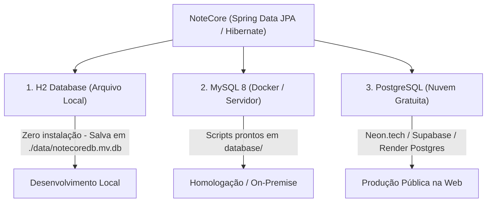

# NoteCore — Guia Completo e Documentação Técnica do Projeto

---

## 1. O Que É o NoteCore e Qual o Intuito Dele?

O **NoteCore** é uma plataforma corporativa e profissional para **gestão unificada de conhecimento, anotações e tarefas**. 

### O Problema que Ele Resolve:
No dia a dia empresarial ou acadêmico, as informações de uma pessoa ou equipe costumam ficar dispersas:
- Trechos de código perdidos em editores temporários;
- Listas de verificação (*checklists*) em blocos de notas voláteis;
- Ideias e minutas de reunião espalhadas sem categorização;
- Ferramentas tradicionais que exigem cadastros complexos, pesam no computador ou salvam dados apenas no `localStorage` do navegador (que se perdem ao limpar o cache).

### O Intuito do NoteCore:
Oferecer um **sistema centralizado, rápido, visualmente elegante e seguro**, onde o usuário possa:
1. Criar notas de diferentes formatos (texto comum, markdown formatado, listas de checagem com progresso e snippets de código);
2. Organizar tudo por categorias, níveis de urgência, tags e favoritos;
3. Acompanhar um quadro de tarefas associado às suas anotações;
4. Ter a certeza de que seus dados estão protegidos por criptografia forte e salvos de forma permanente em banco de dados relacional.

---

## 2. Estrutura de Pastas do Projeto

O projeto adota uma arquitetura limpa e desacoplada:

```text
notecore/
├── back-end/                               # Aplicação Spring Boot 3 (API RESTful + Servidor Full-stack)
│   ├── .mvn/wrapper/                       # Arquivos de configuração do Maven Wrapper
│   ├── mvnw & mvnw.cmd                     # Executáveis do Maven Wrapper (Linux/Mac e Windows)
│   ├── pom.xml                             # Gerenciador de dependências e build do Maven
│   └── src/
│       ├── main/
│       │   ├── java/com/noteservice/       # Código-fonte Java (Controllers, Services, Models...)
│       │   └── resources/
│       │       ├── application.properties  # Configuração padrão (H2 local persistente em arquivo)
│       │       ├── application-prod.properties # Configuração para nuvem (Render, Supabase, Neon)
│       │       ├── application-mysql.properties# Configuração para MySQL 8 local
│       │       └── static/                 # Front-end integrado servido automaticamente pelo Spring
│       └── test/                           # Suíte de 26 testes automatizados (JUnit 5 + MockMvc)
├── database/                               # Scripts SQL de schema e carga para MySQL
│   ├── 01-create-database.sql
│   ├── 02-schema.sql
│   └── 03-seed-data.sql
├── front-end/                              # Código-fonte estático desacoplado (Vanilla JS / CSS)
│   ├── assets/logo.svg                     # Logotipo oficial
│   ├── css/styles.css                      # Estilos responsivos e temas claro/escuro
│   ├── js/                                 # api.js, app.js, auth.js, data.js, i18n.js
│   └── index.html                          # Interface Single Page Application
├── Dockerfile                              # Receita multi-stage para publicação em nuvem (Render/Railway)
├── docker-compose.yml                      # Orquestração local de contêineres (App + MySQL)
├── .env.example                            # Documentação das variáveis de ambiente suportadas
├── .gitignore                              # Proteção contra vazamento de senhas e dados
├── GUIA_COMPLETO_NOTECORE.md               # Este documento explicativo
└── README.md                               # Manual técnico de referência
```

---

## 3. O Que o Sistema Tem (Funcionalidades)

### 3.1 Autenticação e Gestão de Usuários
- **Cadastro de Contas:** Validação em tempo real de nome, e-mail corporativo válido e senha com confirmação (mínimo de 6 dígitos).
- **Criptografia Segura:** Senhas transformadas em hash criptográfico **BCrypt** com sal gerado automaticamente antes de serem salvas.
- **Login com JWT:** Geração de token criptografado (*JSON Web Token*) com expiração de 24 horas.
- **Isolamento de Dados (*Multi-tenant*):** O usuário "A" nunca tem acesso às notas ou tarefas do usuário "B". Todas as consultas no banco são filtradas pelo identificador do usuário autenticado.
- **Demonstração Pré-carregada:** Conta inicial de exemplo com a usuária `ana.moura@notecore.com` e senha `notecore123`.

### 3.2 Tipos Polimórficos de Anotações
O NoteCore suporta 4 naturezas distintas de notas em uma mesma interface:
1. **Texto Puro (`TextNote`):** Para recados rápidos, ideias e descrições simples.
2. **Lista de Verificação (`ChecklistNote`):** Permite adicionar itens com caixas de seleção interativas. Calcula em tempo real uma **barra de progresso visual** percentual conforme as tarefas são marcadas como concluídas.
3. **Documento Formatado (`MarkdownNote`):** Editor com suporte a títulos (`#`), negrito, itálico, listas e citações, com barra de atalhos e pré-visualização instantânea.
4. **Snippet de Código (`CodeNote`):** Bloco monoespaçado com seleção de linguagem (JavaScript, Python, Java, SQL, Shell/Bash, HTML/CSS) e botão de **cópia rápida com 1 clique**.

### 3.3 Organização e Taxonomia
- **Categorias Hierárquicas:** Separação por setores (ex.: *Tecnologia*, *Estratégia*, *Operações*, *Comercial*).
- **Tags Dinâmicas:** Adição de etiquetas personalizadas separadas por vírgula ou Enter (ex.: `#sprint`, `#producao`). O sistema padroniza tudo em minúsculas e remove duplicatas.
- **Níveis de Urgência:** Identificação visual por cores (*Baixa*, *Média*, *Alta*).
- **Favoritos:** Marcação rápida com estrela para acesso imediato no menu lateral.
- **Lixeira com Duplo Estágio:**
  - *Soft Delete:* A nota excluída vai para a Lixeira, podendo ser restaurada a qualquer momento.
  - *Hard Delete:* Exclusão permanente do banco de dados na tela da Lixeira.
  - *Expurgo Automático:* Serviço em background que remove automaticamente notas da lixeira após 30 dias.

### 3.4 Quadro de Tarefas Integrado
- Menu lateral exclusivo para tarefas vinculadas ou não a notas.
- Seletor de status em tempo real: *Pendente*, *Em Andamento*, *Concluída*.
- Filtros rápidos por status e campo de busca instantâneo.

### 3.5 Identidade Visual, Acessibilidade e Idiomas
- **Temas Claro e Escuro:** Alternância suave no cabeçalho com persistência no navegador.
- **Internacionalização (i18n):** Tradução dinâmica instantânea entre **Português (PT-BR)** e **Inglês (EN)** com um clique, cobrindo botões, formulários, alertas e mensagens de erro.
- **Layout Responsivo:** Funciona perfeitamente em telas de computadores, notebooks, tablets e smartphones.

---

## 4. Como Funciona o Código do Back-End (Java 21 + Spring Boot 3)

O back-end foi construído seguindo as melhores práticas da engenharia de software e a arquitetura em camadas do Spring Framework:

### 4.1 Camada de Controle (`com.noteservice.controller` e `auth`)
- **`AuthController.java`:** Expõe os endpoints públicos `/api/auth/register` e `/api/auth/login`. Recebe as credenciais em DTOs imutáveis, valida anotações como `@NotBlank` e `@Email` e devolve o token JWT assinado.
- **`NoteController.java`:** Gerencia as operações de notas (`/api/notes`). Extrai o `userId` autenticado diretamente do token JWT injetado no contexto de segurança do Spring.
- **`TaskController.java`:** Controla as rotas de tarefas (`/api/tasks`).

### 4.2 Camada de Serviços e Regras de Negócio (`com.noteservice.service` e `auth`)
- **`AuthService.java`:**
  - No registro, verifica se o e-mail já existe (`existsByEmailIgnoreCase`). Se existir, lança exceção de negócio; caso contrário, criptografa a senha com `BCrypt` e salva o novo usuário.
  - No login, valida a existência do e-mail e compara a senha digitada com o hash salvo no banco através de `passwordEncoder.matches()`. Se aprovado, emite o JWT.
- **`NoteService.java`:**
  - Centraliza a lógica de criação, validação de títulos duplicados, atualização de status e pesquisa.
  - Garante o **isolamento multi-tenant**: todas as buscas utilizam o `userId` autenticado, impedindo qualquer vazamento de dados entre contas.

### 4.3 O Padrão de Projeto Strategy (`com.noteservice.strategy`)
Em vez de utilizar uma sequência frágil de `if (tipo == TEXT) ... else if (tipo == CHECKLIST)`, o NoteCore implementa o **Design Pattern Strategy**:
- **`NoteTypeHandler` (Interface):** Define o contrato de validação, criação, atualização e conversão para DTO de cada tipo de nota.
- **Implementações:** `TextNoteHandler`, `ChecklistNoteHandler`, `MarkdownNoteHandler`, `CodeNoteHandler`.
- **`NoteHandlerRegistry`:** Localiza automaticamente a estratégia correta com base no enum `NoteType`. Caso seja necessário criar um 5º tipo de nota no futuro, basta criar uma nova classe sem alterar o código existente (Princípio Aberto/Fechado do SOLID).

### 4.4 Camada de Dados e Entidades JPA (`com.noteservice.model` e `repository`)
- **`User.java`:** Representa o usuário cadastrado, com colunas `id`, `name`, `email` (único) e `password_hash`.
- **`Note.java`:** Utiliza herança JPA com a estratégia `SINGLE_TABLE`:
  - A tabela única `notes` armazena os atributos comuns (`title`, `category`, `urgency`, `user_id`, `created_at`, `updated_at`, etc.).
  - A coluna `note_type` discrimina o tipo da nota.
  - As classes filhas (`TextNote`, `ChecklistNote`, `MarkdownNote`, `CodeNote`) utilizam os campos de conteúdo correspondentes.
- **`Task.java`:** Representa tarefas vinculadas ao usuário.
- **`NoteSpecification.java`:** Constrói consultas SQL dinâmicas com a **JPA Criteria API**, permitindo pesquisas textuais por substring combinadas com filtros simultâneos de categoria, tag e autor.

### 4.5 Segurança e Filtro de Requisição (`com.noteservice.auth` e `config`)
- **`SecurityConfig.java`:** Define a política de segurança do Spring Security 6:
  - Rotas públicas liberadas: `/`, `/index.html`, `/css/**`, `/js/**`, `/assets/**`, `/api/auth/**`.
  - Rotas protegidas exigindo token: `/api/notes/**`, `/api/tasks/**`.
  - Sessão configurada como `STATELESS` (não guarda estado no servidor; o cliente envia o token JWT a cada requisição).
  - CORS aberto para permitir comunicação de qualquer origem necessária.
- **`JwtFilter.java`:** Intercepta todas as requisições HTTP antes de chegarem aos controladores. Lê o cabeçalho `Authorization: Bearer <token>`, valida a assinatura criptográfica e registra o usuário no `SecurityContextHolder`.

---

## 5. Como Funciona o Código do Front-End

O front-end foi construído em **JavaScript moderno (ES6+), HTML5 semântico e CSS3 puro**, sem a necessidade de frameworks pesados como React ou Angular. Isso garante inicialização instantânea e baixíssimo consumo de memória.

- **`api.js` (Cliente HTTP):**
  - Encapsula as chamadas `fetch()` para a API REST.
  - Detecta automaticamente se está rodando localmente (`localhost:8080`) ou em produção na nuvem (`window.location.origin`), montando a URL base de forma inteligente.
  - Injeta automaticamente o cabeçalho `Authorization: Bearer <token>` em todas as requisições privadas.
  - Redireciona de forma limpa caso o token expire.
- **`auth.js` (Gestor de Sessão):**
  - Armazena e recupera o token JWT e os dados básicos do usuário no `localStorage`.
  - Verifica a expiração do token diretamente no cliente antes de fazer chamadas desnecessárias.
- **`app.js` (Controlador da Interface):**
  - Gerencia toda a renderização da tela, cards de notas, barra de progresso dos checklists, abertura de modais, alternância de seções e filtros.
- **`i18n.js` (Motor de Idiomas):**
  - Dicionário com todas as frases da aplicação em Português e Inglês, permitindo a troca de idioma sem recarregar a página.
- **`styles.css`:**
  - Define o design corporativo com **CSS Custom Properties** (variáveis CSS), facilitando a alternância entre modo claro e modo escuro.

---

## 6. O Banco de Dados Que Ele Usa

O NoteCore possui **suporte triplo inteligente**, adaptando-se automaticamente ao ambiente:



### 1. H2 Database em Arquivo (Padrão para Uso Local)
- **Como funciona:** O H2 roda embutido no próprio Java, salvando os dados no arquivo `./data/notecoredb.mv.db`.
- **Vantagem:** **Zero instalação**. Não precisa instalar MySQL, PostgreSQL ou Docker. Basta executar o projeto e ele cria o banco e persiste todos os cadastros e notas no disco.

### 2. MySQL 8 (Para Contêineres e Servidores Dedicados)
- **Como funciona:** Ativado com o perfil `mysql` (`-Dspring-boot.run.profiles=mysql`).
- **Scripts inclusos:** A pasta `database/` contém os scripts SQL idempotentes (`01-create-database.sql`, `02-schema.sql`, etc.) para quem prefere rodar via `docker compose up -d` ou Workbench.

### 3. PostgreSQL (Para Hospedagem Pública Gratuita na Internet)
- **Como funciona:** Plataformas de nuvem modernas (Render, Supabase, Neon.tech, Railway) oferecem bancos PostgreSQL gratuitos perpétuos.
- **Compatibilidade nativa:** O driver do PostgreSQL foi adicionado ao `pom.xml`, permitindo que o Hibernate reconheça e crie todas as tabelas na nuvem automaticamente a partir da variável `SPRING_DATASOURCE_URL`.

---

## 7. Como Executar o Projeto Localmente

### Opção 1: Inicialização Automática em 1 Clique (Recomendado — Sem Terminal)
Basta dar **dois cliques** no arquivo executável localizado na raiz do projeto:
👉 **`INICIAR_NOTCORE.bat`**

O script faz tudo automaticamente:
1. **Evita instâncias duplicadas:** Verifica se a porta 8080 já está ativa. Se já estiver, apenas abre o navegador sem recarregar o servidor;
2. **Verifica o Java:** Confirma se o JDK está disponível no sistema;
3. **Inicia o back-end com Maven Wrapper:** Executa `mvnw.cmd spring-boot:run` em uma janela separada;
4. **Aguarda o servidor responder:** Faz testes de verificação automática na porta 8080 até obter resposta `200 OK`;
5. **Abre o navegador automaticamente:** Abre o NoteCore em `http://localhost:8080` com front-end e back-end 100% conectados;
6. **Exibe mensagens claras:** Caso ocorra qualquer erro ou timeout, informa o motivo e orienta a verificar a janela de logs.

Para desligar o servidor quando terminar de usar:
👉 Dê dois cliques em **`parar-notecore.bat`** (ele encerra o processo do NoteCore na porta 8080 e libera a memória).

---

### Opção 2: Utilizando o Maven Wrapper via Terminal (Opcional)
No terminal, dentro da pasta `back-end`:

**No Windows (PowerShell ou Prompt):**
```powershell
cd back-end
.\mvnw.cmd spring-boot:run
```

**No Linux ou macOS:**
```bash
cd back-end
./mvnw spring-boot:run
```

Acesse no navegador: **[http://localhost:8080](http://localhost:8080)**

---

### Opção 3: Executando o JAR Compilado Diretamente
Se você já gerou o arquivo `.jar`:
```bash
cd back-end
java -jar target/note-service-1.0.0.jar
```
Acesse: **[http://localhost:8080](http://localhost:8080)**

---

## 8. Como Publicar na Internet (Acesso Público por Link)

Para que qualquer pessoa consiga acessar o NoteCore por um link público gratuito:

1. **Subir o código para o GitHub:**
   Crie um repositório no seu GitHub e envie os arquivos do projeto.
2. **Criar Banco de Dados Gratuito:**
   Crie um banco PostgreSQL gratuito em **[neon.tech](https://neon.tech)** ou **[supabase.com](https://supabase.com)** e copie a URL de conexão JDBC.
3. **Publicar no [Render.com](https://render.com):**
   - Conecte o repositório do GitHub no Render como **Web Service**.
   - O Render detectará o `Dockerfile` automaticamente.
   - Nas variáveis de ambiente, informe `SPRING_PROFILES_ACTIVE=prod`, o `JWT_SECRET` e a URL do banco (`SPRING_DATASOURCE_URL`).
4. **Pronto!** Em cerca de 2 minutos você terá uma URL pública (ex.: `https://notecore.onrender.com`) com HTTPS ativo para compartilhar.
