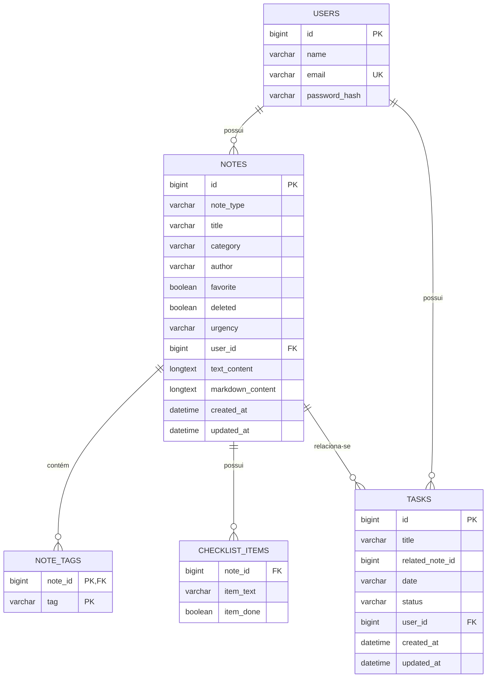

# NoteCore — Sistema Integrado de Gestão de Notas e Tarefas


---

## 1. Apresentação do Projeto

### 1.1 Nome e Propósito
O **NoteCore** é uma plataforma moderna e completa para criação, organização, pesquisa e gerenciamento de notas pessoais, corporativas e operacionais, acompanhada de um quadro integrado de tarefas. O sistema foi unificado para integrar a interface visual fluida e responsiva (Single Page Application) com uma API RESTful de alta performance construída sobre Spring Boot 3 e persistência robusta em banco de dados relacional.

### 1.2 Problemas que Resolve
- **Fragmentação de Anotações:** Elimina a dispersão de ideias em múltiplos aplicativos, centralizando texto puro, anotações formatadas em Markdown e listas de checagem em um único ambiente.
- **Insegurança e Falta de Isolamento:** Oferece autenticação segura baseada em tokens JWT e hash de senhas via BCrypt, garantindo que nenhum usuário tenha acesso às notas ou tarefas de outros usuários (*multi-tenant* lógico estrito).
- **Sobrecarga de Microsserviços Incompletos:** Soluciona a complexidade excessiva de microsserviços inacabados, consolidando regras de negócio em uma arquitetura limpa, coesa e modular, de fácil manutenção e inicialização imediata.
- **Dados Voláteis:** Substitui implementações temporárias baseadas em `localStorage` por persistência transacional real em banco de dados relacional (H2 para desenvolvimento rápido ou MySQL 8 para homologação e produção).

### 1.3 Principais Funcionalidades
- **Autenticação Segura:** Cadastro de novos usuários e login com geração de token JWT (expiração configurável) e criptografia BCrypt.
- **Tipos Polimórficos de Notas:**
  - *TextNote:* Anotações em texto tradicional.
  - *ChecklistNote:* Notas com itens de lista de verificação (tarefas interativas marcadas como concluídas ou pendentes, com barra de progresso visual).
  - *MarkdownNote:* Anotações ricas com formatação Markdown, barra de ferramentas de formatação e pré-visualização em tempo real.
  - *CodeNote:* Snippets de código com seleção de linguagem (JavaScript, Python, Java, SQL, Shell, etc.), formatação monoespaçada e botão de cópia rápida.
- **Taxonomia e Organização:**
  - Categorização hierárquica (ex.: Tecnologia, Estratégia, Operações, Comercial, etc.).
  - Sistema dinâmico de *tags* normalizadas em caixa baixa e sem duplicidade.
  - Níveis de urgência visual (*baixa*, *média*, *alta*).
  - Marcação de notas como favoritas para acesso rápido.
- **Mecanismo Avançado de Busca e Filtros:** Pesquisa textual instantânea por substring em títulos, categorias, autores e tags; filtros combinados por tipo (Texto, Checklist, Markdown, Código), categoria e etiquetas.
- **Ciclo de Vida e Lixeira:** Envio para a lixeira (*soft delete* com reversão a qualquer momento) e exclusão definitiva (*hard delete*).
- **Gestão Completa de Tarefas:** Adição de novas tarefas com vínculo a notas, edição de tarefas existentes, exclusão com confirmação, alternância rápida de conclusão via checkbox, filtros dinâmicos de status (*todas*, *pendente*, *andamento*, *concluída*), busca de tarefas e sincronização instantânea com a API REST no backend.
- **Internacionalização (i18n):** Suporte nativo e instantâneo a Português Brasileiro (pt-BR) e Inglês (en-US), com persistência da preferência do usuário.
- **Identidade Visual e Acessibilidade:** Design sofisticado com paleta de cores original, modo escuro nativo, transições suaves e responsividade para desktop, tablets e smartphones.

### 1.4 Público-Alvo
Desenvolvedores, estudantes, equipes de projeto e usuários que necessitam de um bloco de notas moderno, rápido, seguro e acessível tanto pela web quanto por integrações de API.

---

## 2. Estrutura das Pastas

```text
notecore/
├── back-end/                               # Aplicação Spring Boot 3 (API REST e Camadas)
│   ├── src/
│   │   ├── main/
│   │   │   ├── java/com/noteservice/
│   │   │   │   ├── auth/                   # Autenticação JWT, DTOs, Filter e Service
│   │   │   │   │   ├── dto/                # LoginRequest, SignupRequest, AuthResponse
│   │   │   │   │   ├── AuthController.java
│   │   │   │   │   ├── AuthService.java
│   │   │   │   │   ├── JwtFilter.java
│   │   │   │   │   └── JwtUtil.java
│   │   │   │   ├── config/                 # Configurações de Segurança e Carga Inicial
│   │   │   │   │   ├── DataInitializer.java# Carga inicial com usuário e notas demo
│   │   │   │   │   └── SecurityConfig.java # Spring Security 6, CORS e Filtro Stateless
│   │   │   │   ├── controller/             # NoteController (Endpoints de Notas e Tags)
│   │   │   │   ├── dto/                    # DTOs imutáveis (Records) de notas e erros
│   │   │   │   ├── exception/              # GlobalExceptionHandler e Exceções de Domínio
│   │   │   │   ├── model/                  # Entidades JPA (Note, TextNote, ChecklistNote...)
│   │   │   │   ├── repository/             # NoteRepository (Spring Data JPA)
│   │   │   │   ├── service/                # NoteService (Regras de negócio e isolamento)
│   │   │   │   ├── specification/          # JPA Criteria API (Search & Filter engine)
│   │   │   │   ├── strategy/               # Strategy Pattern para polimorfismo de notas
│   │   │   │   ├── task/                   # Módulo de Tarefas (Entidade, Controller, Service)
│   │   │   │   │   ├── dto/                # TaskRequest, TaskResponse
│   │   │   │   │   ├── Task.java
│   │   │   │   │   ├── TaskController.java
│   │   │   │   │   ├── TaskRepository.java
│   │   │   │   │   └── TaskService.java
│   │   │   │   └── user/                   # Entidade User e UserRepository
│   │   │   │       ├── User.java
│   │   │   │       └── UserRepository.java
│   │   │   └── resources/
│   │   │       ├── application.properties      # Configuração padrão (H2 em memória)
│   │   │       ├── application-mysql.properties# Perfil de produção (MySQL 8)
│   │   │       └── static/                     # Front-end integrado servido pelo Spring Boot
│   │   │           ├── assets/                 # Logotipo SVG e ícones
│   │   │           ├── css/                    # Folha de estilos original (styles.css)
│   │   │           ├── js/                     # Scripts modulares (api.js, auth.js, app.js...)
│   │   │           └── index.html              # Ponto de entrada visual
│   │   └── test/                               # Suíte de testes automatizados
│   │       └── java/com/noteservice/
│   │           ├── AuthControllerTest.java     # Testes de registro e login via MockMvc
│   │           ├── NoteControllerTest.java     # Testes de integração de endpoints de notas
│   │           ├── NoteServiceTest.java        # Testes de unidade e regras de negócio
│   │           └── TaskControllerTest.java     # Testes de CRUD de tarefas com JWT
│   └── pom.xml                                 # Dependências Maven e plugins de build
├── database/                                   # Scripts SQL e infraestrutura de banco
│   ├── 01-create-database.sql                  # Criação de schema e usuário MySQL
│   ├── 02-schema.sql                           # DDL completo das tabelas e índices
│   └── 03-seed-data.sql                        # Carga inicial idempotente (SQL puro)
├── front-end/                                  # Código-fonte estático da interface (Vanilla)
│   ├── assets/logo.svg                         # Logotipo vetorial NoteCore
│   ├── css/styles.css                          # Folha de estilo completa e original
│   ├── js/
│   │   ├── api.js                              # Cliente HTTP Fetch com injeção de JWT
│   │   ├── app.js                              # Controlador SPA da interface
│   │   ├── auth.js                             # Gerenciador de token JWT no navegador
│   │   ├── data.js                             # Utilitários de sanitização de dados
│   │   └── i18n.js                             # Dicionário e motor de tradução PT/EN
│   └── index.html                              # Arquivo HTML principal da aplicação
├── docker-compose.yml                          # Orquestração do MySQL 8.0 via contêiner
├── .env.example                                # Exemplo documentado de variáveis de ambiente
├── GEMINI.md                                   # Especificação técnica mestre
├── planejamento.md                             # Rastreabilidade de tarefas e progresso
└── README.md                                   # Guia completo do projeto
```

---

## 3. Tecnologias Utilizadas

| Tecnologia | Versão | Função no NoteCore |
|---|---|---|
| **Java** | 21 / 25 | Linguagem base do back-end, utilizando Records e Pattern Matching. |
| **Spring Boot** | 3.3.5 | Framework central para injeção de dependência e servidor embarcado. |
| **Spring Web MVC** | 3.3.5 | Exposição de endpoints RESTful com controladores e DTOs. |
| **Spring Data JPA** | 3.3.5 | Abstração da camada de persistência de dados. |
| **Hibernate ORM** | 6.5.3 | Mapeamento objeto-relacional com herança `SINGLE_TABLE`. |
| **Spring Security** | 6.3.4 | Controle de autenticação e proteção de rotas privadas. |
| **JJWT (io.jsonwebtoken)** | 0.12.6 | Geração e validação de tokens JWT (HMAC-SHA). |
| **Spring Validation** | 3.3.5 | Validação declarativa de entrada via Bean Validation (`@Valid`, `@NotBlank`). |
| **H2 Database** | 2.2.x | Banco de dados em memória para execução rápida sem necessidade de instalação externa. |
| **MySQL** | 8.0+ | Banco relacional corporativo para ambiente de homologação e produção. |
| **HTML5 / CSS3 / ES6+** | Padrão Web | Interface Single Page Application nativa, rápida e responsiva. |
| **JUnit 5 / MockMvc** | 5.10.x | Suíte de testes unitários e de integração de endpoints. |
| **Maven** | 3.9+ | Gerenciador de dependências, ciclo de vida e empacotamento da aplicação. |

---

## 4. Pré-requisitos

Antes de iniciar, certifique-se de ter instalado em seu computador:
1. **Java Development Kit (JDK) 21 ou superior**
   - Para verificar: `java -version`
2. **Apache Maven 3.9 ou superior**
   - Para verificar: `mvn -version`
3. *(Opcional)* **Docker** ou **Podman** (caso deseje rodar o MySQL 8 via contêiner):
   - Para verificar: `docker --version` ou `podman --version`
4. *(Opcional)* **Navegador Web Moderno** (Google Chrome, Firefox, Edge, Brave, etc.)

> [!NOTE]
> O NoteCore foi projetado com suporte nativo a banco de dados em memória (**H2**), permitindo a execução imediata **sem precisar instalar o MySQL**. Caso prefira utilizar MySQL 8, as instruções completas estão descritas a seguir.

---

## 5. Configuração do Banco de Dados

### 5.1 Modo Padrão: H2 (Zero Instalação)
Por padrão, ao iniciar a aplicação sem argumentos adicionais, o Spring Boot utiliza o perfil `default` com o banco H2 em memória. As tabelas são criadas automaticamente e a conta de demonstração da Ana Moura é populada. Nenhuma configuração prévia é necessária!

### 5.2 Modo MySQL 8 via Docker / Podman (Recomendado para MySQL)
Na raiz do projeto, execute:
```bash
docker compose up -d
# ou com Podman:
podman compose up -d
```
Isso iniciará um contêiner MySQL 8 na porta 3306 e executará automaticamente os scripts de inicialização localizados em `database/`.

### 5.3 Modo MySQL 8 Local (Instalação Tradicional)
Caso tenha o MySQL Server instalado localmente:
1. Acesse o terminal MySQL como administrador:
   ```bash
   mysql -u root -p
   ```
2. Execute o script de criação:
   ```sql
   source database/01-create-database.sql;
   source database/02-schema.sql;
   source database/03-seed-data.sql;
   ```
3. No PowerShell (Windows), caso prefira redirecionar:
   ```powershell
   Get-Content database/01-create-database.sql | mysql -u root -p
   Get-Content database/02-schema.sql | mysql -u root -p
   Get-Content database/03-seed-data.sql | mysql -u root -p
   ```

---

## 6. Configuração de Variáveis de Ambiente

O arquivo `.env.example` traz os parâmetros suportados. As variáveis de ambiente podem ser exportadas no terminal antes da execução:

### Linux / macOS (Bash / Zsh)
```bash
export SERVER_PORT=8080
export SPRING_PROFILES_ACTIVE=mysql
export DB_HOST=localhost
export DB_PORT=3306
export DB_NAME=notecore
export DB_USERNAME=notecore
export DB_PASSWORD=notecore123
export JWT_SECRET=notecore-super-secret-key-for-development-only-32chars
```

### Windows (PowerShell)
```powershell
$env:SERVER_PORT="8080"
$env:SPRING_PROFILES_ACTIVE="mysql"
$env:DB_HOST="localhost"
$env:DB_PORT="3306"
$env:DB_NAME="notecore"
$env:DB_USERNAME="notecore"
$env:DB_PASSWORD="notecore123"
$env:JWT_SECRET="notecore-super-secret-key-for-development-only-32chars"
```

---

## 7. Como Executar o Projeto

### Método 1: Inicialização Automática em 1 Clique (Recomendado no Windows)
Não é necessário abrir o terminal nem digitar nenhum comando:
1. Vá até a raiz do projeto e dê **dois cliques** em:
   👉 **`iniciar-notecore.bat`**
2. O script inicia o Spring Boot em segundo plano, aguarda o carregamento e **abre automaticamente seu navegador** em `http://localhost:8080`.
3. Quando quiser encerrar, basta dar dois cliques em:
   👉 **`parar-notecore.bat`**

---

### Método 2: Inicialização via Terminal com Maven Wrapper (Linux / macOS / Windows)
1. Abra o terminal e navegue até a pasta `back-end`:
   ```bash
   cd back-end
   ```
2. Inicie a aplicação com o Maven Wrapper:
   - **Windows:** `.\mvnw.cmd spring-boot:run`
   - **Linux / Mac:** `./mvnw spring-boot:run`
3. Acesse **[http://localhost:8080](http://localhost:8080)**.

---

### Método 3: Execução com JAR Compilado
Se você já realizou o empacotamento:
```bash
cd back-end
mvn clean package -DskipTests
java -jar target/note-service-1.0.0.jar
```
Acesse **[http://localhost:8080](http://localhost:8080)**.

### Método 3: Servidor de Front-End Separado (Opcional)
Se desejar executar o front-end em um servidor estático separado (ex.: Live Server, Nginx, Python ou Node):
```bash
cd front-end
python3 -m http.server 3000
# ou:
# npx serve -p 3000
```
O front-end conectará automaticamente à API em `http://localhost:8080` (graças à configuração de CORS já habilitada no back-end).

---

## 8. Como Utilizar o Sistema

### 8.1 Credenciais de Demonstração
Para acesso imediato com dados de exemplo pré-carregados:
- **E-mail:** `ana.moura@notecore.com`
- **Senha:** `notecore123`

### 8.2 Criando uma Nova Conta
1. Na tela inicial, clique na aba **Criar Conta**.
2. Preencha Nome, E-mail, Senha (mínimo de 6 caracteres) e Confirmação.
3. Clique em **Cadastrar**. O sistema redirecionará para a tela de login.
4. Faça login com suas novas credenciais. Você entrará em um painel privativo e limpo.

### 8.3 Operações com Notas
- **Criar Nota:** Clique no botão `+ Nova Nota` no canto superior direito. Preencha o título, selecione a categoria, nível de urgência (*baixa*, *média*, *alta*), insira tags pressionando Enter ou vírgula, digite o conteúdo e clique em **Criar Anotação**.
- **Editar Nota:** No menu de opções (três pontos) do card ou ao abrir a visualização, selecione **Editar**.
- **Favoritos:** Clique no ícone de estrela de qualquer nota para adicioná-la ou removê-la dos favoritos. Acesse a seção lateral **Favoritas** para visualizá-las.
- **Lixeira (*Soft Delete*):** No menu da nota, escolha **Excluir**. A nota é movida para a Lixeira e pode ser restaurada a qualquer momento.
- **Exclusão Definitiva (*Hard Delete*):** Dentro da Lixeira, clique no ícone de lixeira com cruz para remover a nota permanentemente do banco de dados.
- **Pesquisar e Filtrar:** Utilize o campo de busca no cabeçalho para filtrar notas por título, categoria, autor ou tags.

### 8.4 Painel de Tarefas
Acesse a seção **Tarefas** no menu lateral para visualizar as atividades associadas às notas, com indicação de data e seletor de status em tempo real (*Pendente*, *Em Andamento*, *Concluída*).

### 8.5 Preferências Visuais e Idioma
- **Tema Claro / Escuro:** Clique no ícone de sol/lua na barra superior para alternar o tema.
- **Idioma:** Clique no seletor de idiomas no rodapé lateral para alternar instantaneamente entre **Português (PT)** e **Inglês (EN)**.

---

## 9. Endpoints da API REST

Todas as rotas sob `/api/notes/**` e `/api/tasks/**` exigem o cabeçalho HTTP:
`Authorization: Bearer <seu_token_jwt>`

### 9.1 Autenticação (`/api/auth`)
| Método | Endpoint | Descrição | Status Sucesso |
|---|---|---|---|
| `POST` | `/api/auth/register` | Cria um novo usuário | `200 OK` |
| `POST` | `/api/auth/login` | Autentica e gera token JWT | `200 OK` |

**Exemplo de Resposta de Login:**
```json
{
  "token": "eyJhbGciOiJIUzM4NCJ9...",
  "userId": 1,
  "name": "Ana Moura",
  "email": "ana.moura@notecore.com"
}
```

### 9.2 Notas (`/api/notes`)
| Método | Endpoint | Descrição |
|---|---|---|
| `GET` | `/api/notes/all` | Lista todas as notas ativas do usuário |
| `GET` | `/api/notes?page=0&size=20` | Lista paginada das notas |
| `GET` | `/api/notes/{id}` | Busca nota por ID (com validação de propriedade) |
| `POST` | `/api/notes` | Cria nova anotação |
| `PUT` | `/api/notes/{id}` | Atualiza uma anotação existente |
| `DELETE` | `/api/notes/{id}` | Exclui permanentemente uma nota |
| `GET` | `/api/notes/search?q=termo` | Busca textual ampla em notas |
| `GET` | `/api/notes/filter?type=&tag=&category=` | Filtro multicritério |
| `GET` | `/api/notes/tags` | Lista catálogo de tags distintas do usuário |
| `GET` | `/api/notes/categories` | Lista catálogo de categorias do usuário |
| `POST` | `/api/notes/{id}/tags` | Adiciona tags à nota |
| `DELETE` | `/api/notes/{id}/tags/{tag}` | Remove tag da nota |

**Exemplo de Criação de Nota (POST `/api/notes`):**
```json
{
  "type": "TEXT",
  "title": "Arquitetura NoteCore",
  "category": "Tecnologia",
  "urgency": "alta",
  "tags": ["spring", "java", "jwt"],
  "content": "Sistema integrado com sucesso!"
}
```

### 9.3 Tarefas (`/api/tasks`)
| Método | Endpoint | Descrição |
|---|---|---|
| `GET` | `/api/tasks` | Lista todas as tarefas do usuário logado |
| `POST` | `/api/tasks` | Cria uma nova tarefa |
| `PUT` | `/api/tasks/{id}` | Atualiza status, título ou data da tarefa |
| `DELETE` | `/api/tasks/{id}` | Exclui uma tarefa |

---

## 10. Banco de Dados e Modelagem

### 10.1 Tabelas e Relacionamentos
- **`users`:** Registra identificador, nome, e-mail único e hash BCrypt da senha.
- **`notes`:** Tabela polimórfica que unifica notas de texto, markdown e checklist. Possui chave estrangeira `user_id` vinculada a `users(id)` com `ON DELETE CASCADE`.
- **`note_tags`:** Mapeia a coleção de strings de tags associadas a cada nota (`note_id` com cascata).
- **`checklist_items`:** Armazena os itens individuais de notas do tipo `CHECKLIST` (`item_text`, `item_done`).
- **`tasks`:** Tabela dedicada para tarefas, contendo `title`, `status`, `date`, `related_note_id` e `user_id`.



---

## 11. Testes Automatizados

O projeto conta com testes unitários e de integração abrangendo repositórios, serviços, controladores, autenticação JWT e isolamento de dados.

### 11.1 Como Executar a Suíte de Testes
No terminal, execute:
```bash
cd back-end
mvn clean test
```

### 11.2 Classes de Testes Inclusas
- **`NoteServiceTest` (8 testes):** Criação polimórfica (Text, Markdown, Checklist), regras de validação de duplicidade, busca textual, filtros dinâmicos, adição/remoção de tags e catálogo unificado.
- **`NoteControllerTest` (6 testes):** Validação de códigos de status HTTP (201, 200, 400), cabeçalho `Location`, autorização JWT, paginação e pesquisa REST.
- **`AuthControllerTest` (4 testes):** Registro bem-sucedido, bloqueio de e-mail duplicado (409 Conflict), login com credenciais válidas e rejeição de senhas incorretas.
- **`TaskControllerTest` (1 teste completo):** Ciclo de vida de tarefas (criação, listagem isolada por usuário, atualização de status e remoção).

**Resultado esperado:**
```text
[INFO] Results:
[INFO] Tests run: 19, Failures: 0, Errors: 0, Skipped: 0
[INFO] BUILD SUCCESS
```

---

## 12. Soluções para Problemas Comuns

| Problema | Causa Provável | Solução |
|---|---|---|
| **Porta 8080 já está em uso** | Outro processo local ou container está escutando na porta 8080. | Inicie em outra porta: `mvn spring-boot:run -Dspring-boot.run.arguments="--server.port=8081"`. |
| **Erro de conexão com MySQL** | Serviço do MySQL desligado ou credenciais divergentes. | Verifique se o MySQL ou Docker está ativo (`docker ps`), ou execute no modo padrão H2 (sem parâmetros de MySQL). |
| **Erro 403 Forbidden ao acessar rotas da API** | Token JWT ausente, expirado ou inválido. | Realize login novamente via `/api/auth/login` para renovar o token. |
| **Front-end não carrega estilos ou scripts** | Caminho estático bloqueado no Security. | Corrigido em `SecurityConfig.java`: rotas estáticas `/css/**`, `/js/**`, `/assets/**` possuem acesso público liberado. |
| **Falha na compilação do Maven** | Versão do JDK inferior a 21. | Instale o JDK 21 ou configure a variável `JAVA_HOME`. |

---

## 13. Segurança e Produção

### O que está Implementado e Pronto:
- Senhas protegidas com algoritmo forte **BCrypt** com sal gerado automaticamente.
- Autenticação *stateless* com **JSON Web Tokens (JWT)** assinados criptograficamente.
- **Filtro de autorização** em nível de requisição HTTP (`JwtFilter`).
- **Isolamento de dados multi-tenant** em nível de serviço e repositório JPA.
- Prevenção contra **SQL Injection** através de consultas parametrizadas e *JPA Criteria API*.
- Proteção contra manipulação de tipos polimórficos e duplicidade de títulos.
- Configuração de **CORS** flexível para desenvolvimento e desacoplamento.

### Recomendações para Implantação em Produção:
1. Definir uma chave secreta JWT longa e complexa via variável de ambiente `JWT_SECRET`.
2. Habilitar terminação TLS/SSL (HTTPS) através de certificado (ex.: Let's Encrypt ou proxy reverso Nginx/Cloudflare).
3. Restringir as origens permitidas no CORS (`corsConfigurationSource` em `SecurityConfig.java`) para os domínios oficiais da sua organização.
4. Ajustar as credenciais do MySQL para um usuário com privilégios estritos.

---

## 14. Estado Final do Projeto

- **Front-End:** 100% integrado ao back-end REST, com aparência visual, animações e folhas de estilo integralmente preservadas.
- **Back-End:** Aplicação Spring Boot 3 modular e unificada, com 26 testes automatizados aprovados, arquitetura em camadas e DTOs imutáveis.
- **Banco de Dados:** Suporte triplo transparente: H2 persistente em arquivo (`./data`), MySQL 8 e PostgreSQL em nuvem.
- **Documentação:** README.md e especificações completas em Português do Brasil.

---

## 15. Guia de Publicação na Nuvem (Acesso Público por Link)

Para disponibilizar o NoteCore na internet gratuitamente para qualquer pessoa acessar diretamente pelo navegador:

### 15.1 Passo a Passo para Enviar ao GitHub
1. Abra o terminal na raiz do projeto (`notecore/`).
2. Inicialize o repositório Git e faça o commit inicial:
   ```bash
   git init
   git add .
   git commit -m "feat: NoteCore pronto para producao e publicacao na nuvem"
   ```
3. Crie um repositório no seu GitHub (público ou privado).
4. Vincule e envie o código:
   ```bash
   git branch -M main
   git remote add origin https://github.com/SEU_USUARIO/notecore.git
   git push -u origin main
   ```

### 15.2 Publicando no Render.com (Plano Gratuito)
1. Acesse **[Render.com](https://render.com)** e faça login com sua conta do GitHub.
2. No painel, clique em **New +** e selecione **Web Service**.
3. Conecte o repositório `notecore` do seu GitHub.
4. Preencha as configurações:
   - **Name:** `notecore`
   - **Region:** Ohio (US East) ou Frankfurt
   - **Language:** `Docker` (o Render detectará automaticamente o `Dockerfile` na raiz!)
   - **Plan:** `Free`
5. Em **Environment Variables**, adicione:
   - `PORT`: `8080`
   - `SPRING_PROFILES_ACTIVE`: `prod`
   - `JWT_SECRET`: *(gere uma chave segura aleatória com mais de 32 caracteres)*
   - *(Opcional)* `SPRING_DATASOURCE_URL`: Caso queira conectar ao PostgreSQL gratuito (do próprio Render, Supabase ou Neon.tech). Se não definir, o NoteCore utilizará o banco H2 persistente em `./data`.
6. Clique em **Create Web Service**.
7. Aguarde a finalização do build. Em poucos minutos, você receberá um link público com HTTPS:
   👉 `https://notecore.onrender.com` (ou similar) acessível de qualquer lugar!

